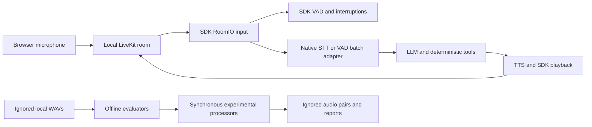
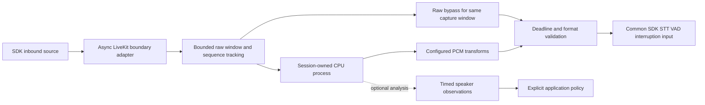

# Voice-Starter audio architecture

* Author: Koushikroyal2005
* Status: Proposed
* Date: 2026-11-16

Current source: `voice-optimization`, `bf477d13e3358bd74405330666356e29f729a684`.
The voice application works independently of the experimental processors. All
production processing described as proposed below remains unimplemented.
See [system trust boundaries](docs/architecture.md) and the subsequent
[architecture review](docs/audio-processing-architecture-review.md).

## Intended system

Keep LiveKit responsible for room transport, tracks, STT streaming interfaces,
VAD, endpointing, speech interruption and playback cancellation. An optional,
session-owned inbound audio adapter may eventually transform PCM before the SDK
distributes it to STT and audio-based turn/interruption consumers. The application
continues to own provider configuration, deterministic tools and authorization.

Current paths (the lower path has no connection to a live session):

Proposed optional path, replacing only the Input-to-consumers edge above:

The browser sends media across a room trust boundary. Raw audio and speaker
enrollment remain private session data; model scores do not establish identity.
Both diagrams have text equivalents in the current/proposed flow descriptions.

## Responsibilities

**Current implementation.**

- `backend/app/main.py`: one worker job, `AgentSession`, room attachment and
  existing infrastructure/workbench shutdown hooks. `bootstrap.py` composes the
  use case and tools; neither composes experimental audio processors.
  The installed SDK defaults to threaded job execution on Windows, not a separate
  process per job. Do not assume job-local environment changes are isolated.
- `app/providers/pipeline.py`: creates native STT/LLM/TTS, Silero VAD and bounded
  provider fallback adapters. Batch STT uses LiveKit `stt.StreamAdapter` with VAD;
  this does not create native interim transcripts. `groq_nvidia` selects Groq
  STT/LLM, NVIDIA TTS and VAD turn detection through existing configuration.
- `app/config/`: resolves trusted YAML voice profiles, server environment and
  provider capability validation. There is currently no production audio chain
  setting. Provider fallback is distinct from future PCM-processing bypass.
  Installed RoomIO defaults are mono 24 kHz with 50 ms input frames; the current
  worker does not override those defaults. The 48 kHz RNNoise/DFN3 and 16 kHz
  VoxLock experiments therefore cannot be inserted without explicit conversion.
- `app/audio/interfaces.py`: immutable PCM16 bytes and explicit rate/channel
  metadata; synchronous `process`, `flush`, `close`, and optional enrollment.
  Empty output means buffering. This is an evaluation contract, not an async
  transport, multi-speaker result or authentication interface.
- `app/audio/processors/`: RNNoise uses mono 48 kHz/480-sample frames; VoxLock
  uses mono 16 kHz, enrollment and local INT8 ONNX; DeepFilterNet uses mono 48 kHz
  and buffers a complete clip for its official Windows CPU executable. Each owns
  mutable stream state; callers currently use separate serial instances.
- `app/evaluation/`: PCM fixtures, sample-rate-aware scoring, timing/resource
  measurements and optional roomless SDK replay. Some generic readers/measurement
  helpers still live in model-named evaluators. Evaluation may import processors;
  future production code must not import evaluation modules.
- `app/observability/session.py`: observes actual SDK stages and correlates turns;
  missing measurements stay unknown. Workbench/frontend consume real SDK states,
  tracks and safe events. They do not receive model objects or enrollment audio.

**Proposed boundaries, introduced only with an authorized implementation.**

Reuse synchronous PCM transforms inside the worker process. One small adapter
converts SDK frames at the boundary and one supervisor owns scheduling, bounded
IPC, deadline selection and shutdown. Each processor owns only its model/stream;
it must not decide STT providers, turn policy, tools, browser state or retry policy.
Use an explicit factory with known names if selection is needed; do not create a
second STT/provider registry, plugin loader, service locator or general graph engine.

An ordered list is enough for future transforms such as noise reduction and
selected-source separation. Speaker verification and multiple-speaker detection
produce observations, not replacement audio; do not squeeze scores/labels into
`PCMChunk`. When implemented, use small typed results with capture-window offsets,
status/unknown and model revision. A separation implementation must explicitly
select one output for this mono voice path; multi-output routing is a later design.
No speaker gate or automatic enrollment is proposed in the first integration.

## Data model

- **Existing PCM:** signed little-endian interleaved PCM16, positive sample rate,
  one or two channels. Individual current models accept mono at their own rate.
  Boundary adapters own explicit downmix/resampling/reframing and their state;
  models never silently reinterpret a rate or channel count.
- **Proposed stream identity:** one session/participant/track epoch, ordered frame
  sequence and capture sample offset. Track replacement or reconnect creates a
  fresh epoch/model state and clears enrollment/results from the previous track.
- **Proposed immutable session selection:** disabled or a validated ordered chain,
  model revisions/formats, live-eligibility facts, buffering/delay bounds, queue
  duration cap, deadlines, resource/admission limits and failure policy. No hot
  model switching mid-utterance. Reject unknown names; no arbitrary import paths.
  Existing voice profiles remain STT/LLM/TTS configuration. Resolve an independent
  optional audio section once per session; absent means unchanged SDK path.
- **Proposed worker envelope:** epoch, sequence/window, PCM, declared output
  format and model-delay mapping. Keep this outside the existing PCM interface;
  execution scheduling is not a model responsibility. No unbounded audio history.
- **Observations/enrollment:** explicit consent and session/participant scope;
  short-lived memory only by default. A speaker score is neither account identity
  nor tool permission. Persistent biometric storage needs a separate design.
- **Evidence:** existing benchmark JSON/WAVs remain Git-ignored and local. Metrics
  contain durations, counters, revisions and correlation IDs, not private audio,
  transcripts, embeddings, credentials or participant identifiers as metric labels.

## Critical flows

1. **Current voice request:** browser joins using the existing development token
   route; RoomIO supplies audio to SDK consumers; native STT yields text; LLM/tools
   produce a response; native TTS and LiveKit deliver/cancel playback. Local CPU
   experiments cannot affect this path because nothing wires them into it.
2. **Disabled proposal:** do not import model dependencies, allocate a worker,
   resample or add a queue. Keep the current SDK input/behavior exactly.
3. **Enabled proposal:** validate the chain before attachment; a spawned Windows
   CPU process constructs models once and signals readiness. The async adapter
   keeps the SDK input moving using bounded IPC and a bounded raw window. It
   emits exactly one validated representation per capture window, in order.
4. **Admission/deadline/overload:** one admission owner per Windows AgentServer
   instance grants a bounded audio-child slot before startup. It synchronizes
   requests across job threads; a session supervisor cannot grant its own slot.
   Without capacity, keep that session on raw input without spawning a child.
   Retain the slot until failed initialization/normal shutdown has reaped the child.
   This is a one-server bound: multiple server instances need divided operator
   quotas, not an assumed laptop-wide guarantee. Cross-platform job-process IPC
   admission is a later portability gate, not an added resource microservice.
   On a processing deadline,
   release the corresponding raw capture window at its
   established playout deadline, discard late processed output, disable the chain
   for the rest of that epoch, and close/reap the worker. Never queue more work
   indefinitely or retry frames already emitted. No automatic retry storm.
5. **Failure before ready:** optional quality processing degrades to raw audio
   with a metadata-only reason. An explicit future security/verification gate must
   fail closed or request a trusted alternative; raw bypass cannot grant access.
6. **Shutdown:** stop admission, detach callbacks, invalidate epoch, discard stale
   work/tail, request worker cleanup, wait a bounded grace period, terminate/join
   if necessary, then release IPC/buffers. Construct/process/flush/close all run
   serially in the same worker. Never close a model concurrently with inference.
   Live stop discards stale tails; offline completion may flush for a listening file.

**Timeline constraint:** RNNoise currently emits delayed samples without timestamps;
the experiment estimates 20 ms delay, while DFN3 estimates 30 ms. A future adapter
must validate delay mapping and align raw fallback to the same capture windows
under one fixed, bounded playout schedule. Initial/final samples and resampler
delay need explicit tests. Do not switch between a delayed processed frame and
current raw audio, duplicate speech, silently shorten an utterance, or fake silence
when a model buffers. Until this mapping is proven, that model is not live-eligible.

**SDK attachment constraint:** inspected installed LiveKit Agents 1.8.12 exposes
`io.AudioInput` and `session.input.audio`. RoomIO attaches its own source during
startup. The exact attach/detach ordering must pass an SDK contract test before
integration; this document does not invent a pre-start option that preserves a
custom wrapper. Inspect `voice/room_io/room_io.py` and `voice/audio_recognition.py`.
An STT-node-only override leaves other SDK consumers on raw audio. The existing
`rtc.FrameProcessor._process` path is synchronous and cannot host expensive
inference on the event loop. Do not patch SDK internals to force either approach.

Rules and acceptance checks:

- **INV-1:** Disabled processing preserves the existing media/session behavior.
  Check a golden disabled-path session and absence of optional model imports.
- **INV-2:** At most one emission per capture window; ordered epochs/formats and
  delay-correct bypass. Check irregular chunks, rate conversion, partial frames,
  buffering, late results, track switches and disconnect races.
- **INV-3:** No expensive initialization, inference, resampling or blocking IPC
  waits on the event loop. Check heartbeat latency under slow/hung workers and
  concurrent sessions; include parent PCM conversion/IPC overhead in the budget.
- **INV-4:** Queue age, duration/bytes, CPU process count and memory are bounded.
  Check simultaneous worker-wide admissions, initialization failure, slot release
  only after reaping, unavailable capacity and worker death; emit bypass counters.
- **INV-5:** One owner/state per track epoch; all cleanup is attempted even after
  partial initialization or another cleanup failure. Check repeated start/stop,
  hung native work, process death and Windows spawn using module-level entrypoints.
- **INV-6:** Optional audio processing does not grant identity, cancel tools or
  bypass deterministic permissions. Check raw fallback and unknown speaker results.
- **INV-7:** SDK owns VAD/turn/interruption/playback behavior; all relevant consumers
  receive the selected common stream. Check speech, text fallback, tools, spoken
  and explicit interruption, reconnect and session-end behavior.
- **INV-8:** Private data stays local/ephemeral unless explicitly authorized.
  Check ignored output paths, metadata schemas and absence of recording by default;
  concurrent child environment tests must exclude secret-bearing variables while
  the parent jobs retain their configured credentials.

## Security and operations

No new deployment or network service is proposed: the worker process is a local
child owned by an existing voice job. The process isolates hangs/lifecycle; it is
not a sandbox for malicious models. Only reviewed local artifacts are allowed;
verify revisions/hashes and licensing, with downloads as an explicit setup step.
Launch the child with a controlled subprocess and an explicit minimal environment
allowlist: required Windows runtime/temp paths and trusted Python/model locations,
without LiveKit/provider keys, inherited arbitrary Python paths or credentials.
The child entrypoint must not load dotenv/settings. Ordinary multiprocessing
environment inheritance does not satisfy this boundary. Never temporarily clear
or mutate the parent environment: concurrent Windows jobs share it. A subprocess
can use Windows spawn semantics without Python multiprocessing's inherited env.

Reuse existing telemetry, adding measured queue wait, inference/IPC duration,
deadline misses, bypass reasons, worker failures/restarts, delay and sampled
memory. SDK stage latency is not microphone-to-ear latency. Unknown values remain
null. Do not retry non-idempotent tools because an audio stage failed.

Current evidence does not approve integration: RNNoise's 60-second synthetic runs
have adequate average throughput but compute overruns and a 690 ms scheduling
outlier; VoxLock's measured RTF exceeds one; DFN3 is batch-only through this adapter.
Real microphone quality, long concurrent-load behavior and perceptual acceptance
remain unverified. See the three model evaluation guides for scopes and results.

## Decisions

| Decision | Chosen | Instead of | Why | Cost |
|---|---|---|---|---|
| Processing boundary | Common async input, before SDK fan-out | STT-only preprocessing | VAD and interruption need the same selected audio | SDK attachment must be proven |
| Execution | Session-owned subprocess with explicit environment | `to_thread` or inherited-env multiprocessing | Bounded termination and credential isolation | IPC, startup and per-session memory |
| Composition | Small ordered chain; reuse PCM transforms | Generic graph/plugin framework | Current variation does not justify a framework | Multi-output separation stays out of scope |
| Recovery | Raw bypass for quality stages; disable failed epoch | Repeated retry or silence | Preserve speech and bound backlog | Bypass/delay alignment and audible transitions need testing |
| Analysis | Separate timed observations, initially informational | Speaker labels embedded in PCM or used as authentication | Different output/policy semantics | Future policy requires its own acceptance tests |

## Open decisions

- **Budgets and laptop capacity:** queue/processing/playout deadlines, termination
  grace, memory and concurrent-process limits are unknown. Recommend deriving them
  from real-mic/controlled-load evidence; require explicit validated limits before
  enabling a live chain. No benchmark value here becomes a product latency SLA.
  The first scope is one Windows AgentServer with a shared admission owner;
  cross-platform/multiple-server deployment requires explicit capacity allocation.
- **SDK attachment:** recommend a public `AudioInput` wrapper only if startup,
  common-consumer routing, flush and detach contract tests pass on pinned 1.8.12.
  Otherwise defer integration or explicitly evaluate an SDK change; never silently
  fall back to STT-only processing for interruption/noise-control claims.
- **Model eligibility:** recommend RNNoise as the first bounded integration spike
  only after the measurement/quality gates pass. Current VoxLock and DFN3 adapters
  remain offline-only. A future live DFN3 adapter requires persistent native state.
- **Speaker policy:** thresholds, consent/enrollment expiry, unknown handling and
  selected-source routing remain unapproved. Keep these capabilities disabled.

Migration sequence requested for this proposal: the evaluation cleanup,
final-chunk-budget and output-guard findings have now been fixed with regression
tests; collect real recordings next, then
prove the SDK seam with a pass-through test adapter; then validate isolated RNNoise
and timeline-safe bypass in an opt-in experiment; finally measure concurrent live
sessions before considering any default change. Add analysis/separation only after
separate evidence and policy review. Roll back by disabling the audio section and
starting a fresh session, which restores the existing direct SDK path. This is a
documentation plan, not authorization or implementation of these stages.
