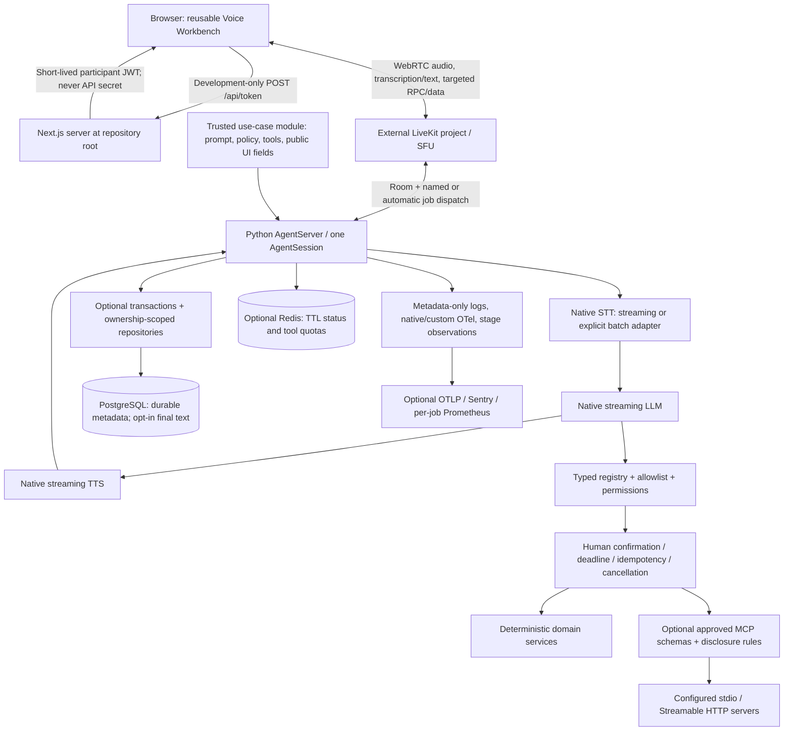

# Architecture and trust boundaries

Text alternative: browser → Next.js dev JWT issuer → external LiveKit room ↔ Python
worker → STT → LLM/tools → TTS → room/browser. Only the worker composes domain
services, approved MCP clients and storage/cache. Browser props/RPC receive explicit
display/result fields, never Settings or provider credentials.

## Responsibilities

- LiveKit owns WebRTC, tracks, native streaming/event interfaces, turn detection,
  speech interruption, queued audio cancellation, session state and dispatch.
- The application owns provider selection, deterministic domain rules, tool
  permissions/confirmation, UI disclosure and persistence policy.
- `backend/app/main.py` is the worker entrypoint; `bootstrap.py` composes one use
  case with the ordinary executor. No application HTTP hop is added per turn.
- `components/voice/` stays domain-neutral. `components/app/` supplies application
  composition; `components/usecases/` supplies optional card renderers.
- Provider/use-case changes require a worker restart/new session, not a dashboard.
- Common DB tables use the `voice_` prefix. Business tables belong elsewhere.
  Redis is disposable; tool history is not a durable idempotency ledger.

## Trust boundaries and limitations

The dev JWT route is blocked outside development. Authenticated stable tenant/user
identity, production authorization and durable business idempotency are not built.
A demo participant ID is not an account. MCP stdio commands are trusted local
programs, not OS-sandboxed plugins; schemas cannot make arbitrary external tools safe.

Worker cloud recording is disabled (`record=False`). App transcript persistence
is opt-in and best-effort redacted, not compliance-grade de-identification.
Browser/device latency and acoustic quality need live testing. See the
[audit](engineering-audit.md), [observability](observability.md) and
[production requirements](../README.md#before-public-production-deployment).
